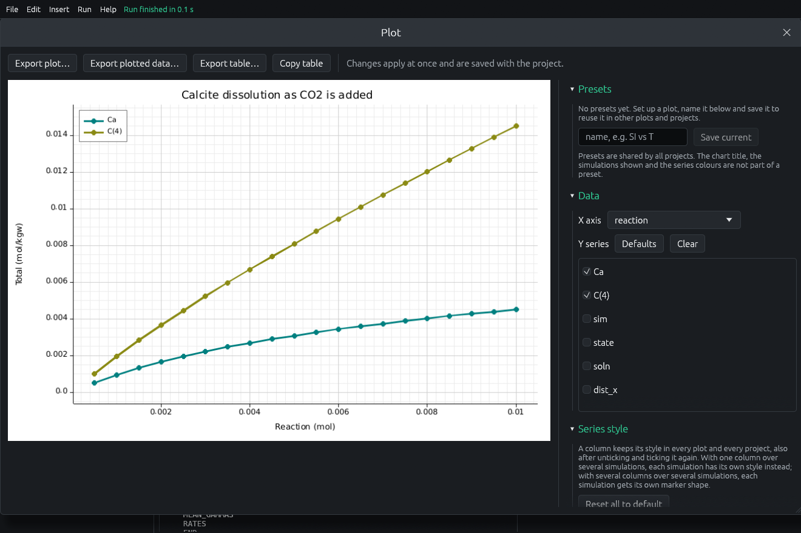

# PQ Studio

A desktop application for building, running and plotting **PHREEQC**
geochemical models on **Windows, macOS and Linux**. You assemble an input
from forms, pick a thermodynamic database, run the unmodified USGS
`phreeqc` engine, then read the output and plot the results. Its workflow is
modelled on the USGS Windows program PHREEQC Interactive (PhreeqcI).



> **Not a USGS product.** PQ Studio is an independent program. It is not
> affiliated with, endorsed by or supported by the U.S. Geological Survey.
> Please don't send questions about it to the USGS or the PHREEQC authors.
> All calculations are done by the unmodified USGS PHREEQC engine; see
> [`dist/NOTICE.md`](dist/NOTICE.md) for details and for where to get the
> original software.

> **Not maintained.** PQ Studio is published as is. Issues and pull requests
> may not get an answer. You are welcome to fork it (MIT licence).

## Features

- Forms for the everyday PHREEQC keywords: SOLUTION, EQUILIBRIUM_PHASES,
  REACTION, REACTION_TEMPERATURE/PRESSURE, MIX, EXCHANGE, SURFACE, GAS_PHASE,
  KINETICS, SOLID_SOLUTIONS, TRANSPORT, ADVECTION, INVERSE_MODELING,
  SELECTED_OUTPUT and more. Other keywords are kept as text, unchanged.
- Opens and saves ordinary PHREEQC input files (`.pqi`).
- Runs the engine in the background, with Cancel, a timeout and a memory
  guard.
- *Simulations from combinations*: run several waters through several
  set-ups (temperatures, phases, reactions) in one go.
- Plots from Selected Output, with per-series colours, lines and markers,
  fixed colours for common minerals, a movable legend, saved presets, and
  export to PNG/SVG or the plotted data to Excel/CSV.

The user guide is in [`dist/README.md`](dist/README.md).

## Install

Download the file for your system from the
[**Releases**](../../releases) page. Every package includes the PHREEQC
engine and its databases; there is nothing else to install.

### Windows 10 and 11 (64-bit)

1. Download `PQ-Studio-<version>-windows-x64.zip`.
2. Right-click it → **Extract All…**, and extract it somewhere permanent,
   such as **Documents**.
3. Open the extracted **PQ Studio** folder and double-click
   **PQ Studio.exe**.
4. If Windows shows "Windows protected your PC", click **More info** →
   **Run anyway** (only the first time; the app isn't code-signed).

To uninstall, delete the folder.

### macOS 11 or later (Apple silicon and Intel)

1. Download and open `PQ-Studio-<version>-macos-universal.dmg`.
2. Drag **PQ Studio** onto **Applications**.
3. The first time, macOS refuses to open it because it isn't notarized by
   Apple:
   - **macOS 15 and later:** try to open it once, click **Done**, then go to
     **System Settings → Privacy & Security** and click **Open Anyway**.
   - **macOS 14 and earlier:** Control-click (right-click) the app in
     Applications, choose **Open**, then **Open** again.
   - **Or in Terminal:**
     `xattr -dr com.apple.quarantine "/Applications/PQ Studio.app"`

To uninstall, drag the app to the Bin.

### Linux (x86_64)

```
tar xzf PQ-Studio-<version>-linux-x86_64.tar.gz
cd PQ-Studio-<version>-linux-x86_64
./install.sh
```

This installs for your user only (no root), adds **PQ Studio** to your
application launcher and a `pq-studio` command. To uninstall, run
`./uninstall.sh` from the same folder.

## Build from source

Install Rust (https://rustup.rs). `cargo run --release` starts the app; it
looks for a `phreeqc` engine on your `PATH` (or set `PHREEQC_BIN` and
`PHREEQC_DATABASE`). `cargo test` runs the tests.

| | Command | Needs |
|---|---|---|
| Linux, install using your own `phreeqc` | `packaging/linux/install.sh` | an installed `phreeqc` |
| Linux package (`.tar.gz`) | `packaging/linux/build-linux.sh` | CMake, a C++ compiler |
| macOS package (`.dmg`) | `packaging/macos/build-macos.sh` | Xcode Command Line Tools, CMake |
| Windows package (`.zip`) | `powershell -ExecutionPolicy Bypass -File packaging\windows\build-windows.ps1` | Visual Studio 2022 Build Tools (C++) |

The package scripts download the official PHREEQC source release, check its
checksum, build the engine without changing it, and write the package to
`dist/out/`. The engine version is set in `packaging/phreeqc.env`.

**Releases on GitHub:** pushing a version tag (for example `v0.1.0`) runs
`.github/workflows/release.yml`, which builds all three packages and
publishes them as a release. `.github/workflows/ci.yml` runs the tests on all
three systems on every push.

Other files: `packaging/licenses/generate.sh` regenerates
`dist/THIRD_PARTY_LICENSES.md` (needs `cargo install cargo-about`).

## Status

PQ Studio was developed and used day to day on Linux. The macOS and Windows
versions are built from the same code, but have had much less testing.

## Licence

- PQ Studio's own code and icon: [MIT](LICENSE).
- The PHREEQC engine and databases bundled in the packages: the USGS User
  Rights Notice, reproduced with an account of how PQ Studio relates to the
  original in [`dist/NOTICE.md`](dist/NOTICE.md). The source repository
  contains no PHREEQC code or data.
- Rust libraries compiled into PQ Studio:
  [`dist/THIRD_PARTY_LICENSES.md`](dist/THIRD_PARTY_LICENSES.md).
- DejaVu fonts used for plot text: [`dist/FONT_LICENSE.txt`](dist/FONT_LICENSE.txt).

If you publish results produced with PQ Studio, please cite PHREEQC:
Parkhurst, D.L., and Appelo, C.A.J., 2013, Description of input and examples
for PHREEQC version 3: U.S. Geological Survey Techniques and Methods, book 6,
chap. A43, 497 p.
